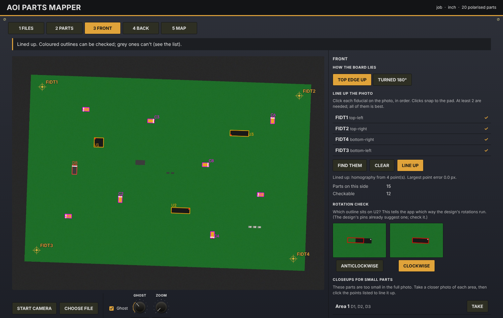

# AOI Parts Mapper

A standalone tool that maps every polarised part on a PCB that can be checked from a photo. It
works for any board: load the board's ODB++ and BOM, take or load a photo of each side, click
the fiducials, and it shows each polarised part with its outline, pin 1 and expected polarity
mark. Parts it can't check are marked with the reason, and for parts too small in the full photo
it plans closeups.

It started from the PTC board QC station's orientation check, but it is a separate program and
doesn't depend on that code.

## Running it

Needs Python 3.10 or newer.

    pip install -r requirements.txt
    python -m aoimap

That opens `http://localhost:8090` in the browser. The camera only works on a page opened at
`localhost`, which is why the tool runs as a small local server.

Options:
- `--port 8091` changes the port.
- `--data D:\aoi` changes where boards are kept. The default is `aoimap-data` in your home folder.
- `--no-browser` stops it opening a browser.

## Using it

1. **Files.** Drop in the ODB++ (`.tgz`, `.tar` or `.zip`) and the BOM (`.csv`, or `.xlsx` with
   openpyxl installed).
   - The tool reads the units from the ODB++, picks the board step (not the panel), and guesses
     which BOM column is which.
   - Check the column choices. It also lists refs that are in the BOM but not on the board, the
     other way round, and DNP parts.
2. **Parts.** Every BOM line the rules think is polarised is listed: ICs, tantalum and
   electrolytic capacitors, diodes and LEDs. Bidirectional TVS and ESD diodes are left out.
   - Change the kind of any line, or mark one as hidden (under a heatsink or shield).
   - **Markings:** for each kind of two-pin part, set which pin the band or + sign is at. The
     usual convention is pin 1, but footprint libraries differ.
   - **Rotation:** ODB++ can store rotations either way round. Auto picks the direction from the
     pin 1 positions when the design allows it.
   - **Min part size:** a part narrower than this in a photo (14 px by default) can't be
     checked, and gets a closeup.
3. **Front and Back.**
   - Choose how the board lies. For the back, that's which way it was turned over: top to
     bottom, or left to right.
   - Start the camera and line the board up with the ghost, then take the photo. You can also
     choose an image file instead. The ghost is the last photo of that side, or before the first
     one, the board outline drawn from the design.
   - Click each fiducial in the order listed. Clicks snap to the pad.
     - Two points are enough (shift, turn and scale), three allow skew, and four or more also
       correct perspective.
     - A board with fewer than 2 fiducials on a side asks for its corners instead.
     - **Find them** tries to find the corner fiducials by itself.
   - **Line up** places every polarised part and colours its outline by kind. Grey means it
     can't be checked, and the list says why: too small, hidden, cut off, or not in the photo.
     Warnings appear if the clicks don't match the design's shape or order, or the photo looks
     like the other side.
   - **Rotation check:** if a part on the side would look different depending on the rotation
     direction, two closeups of it are shown, one drawn each way. Pick the one that fits.
   - **Closeups for small parts:** the parts too small in the full photo are grouped into areas,
     each small enough that a photo of just that area shows them big enough.
     1. Take a closeup of each area.
     2. Click the 2 to 4 points listed: fiducials, or the centres of named parts.
     3. Those parts then count as checkable "on closeup n".
4. **Map.** Shows the totals and every part that still can't be checked, and why. Download the
   CSV here.

Every choice made in the Parts tab is kept in a **board profile**, along with the column mapping,
the orientation of each side, the camera, the size limit and the rotation direction. The profile
is saved per board name, and is reused automatically the next time the same ODB++ is loaded.
**Saved boards** on the Files tab reopens a board with its photos.

## What it saves

Everything is kept under `<data>/boards/<board>/`:

| File | What |
|---|---|
| `profile.json` | The choices above |
| `design.json` | Every polarised part: position, rotation, side, package outline, pin 1 and its direction, kind, value, hidden |
| `parts_map.csv` | One row per part: design data, plus for each side whether it can be checked, why not, its size in pixels and its centre in the photo |
| `front/`, `back/` | `reference.jpg`, `alignment.json` (clicked points and the transform), `parts.json`, `parts_full.json`, `map.jpg`, `closeups/` |

`parts.json` has the same shape as the PTC QC station's orientation check: a list of
`{ref, kind, box: [x, y, w, h]}`. A side's `reference.jpg` and `parts.json` can be copied into
the station's `inspection/<side>/` folder.

## Colours

`aoimap/static/designer.html` is a working preview of the screen, for trying out colours. Open
it in any browser.
- Pick a preset or change any of the 8 colours.
- Press **Copy summary** and paste the result to Claude.
- The colours are the variables at the top of `aoimap/static/app.css`.

## Tests

    python tests/test_engine.py        # or: python -m pytest tests
    python tests/e2e_page.py out/      # drives the page in headless Chromium (needs playwright)

The tests build a made-up two-sided board: an ODB++ with clockwise rotations and off-centre
packages, a BOM with different column names from the PTC's, and photos rendered from a known
camera position. They check:
- the parsing, the column guesses, ref ranges and DNP;
- the kinds and the rotation direction;
- placement within 2 px with 4 fiducials, and within 3 px with 2 or 3;
- snapping and automatic fiducial finding;
- warnings for swapped clicks;
- closeups making the small back LEDs checkable;
- profiles carried to the next board, and markings.

## Limits worth knowing

- **Size of tantalum and fiducial searches.** The colour ranges for gold fiducial pads and
  yellow tantalum capacitors, and the size limits, come from the PTC photos and are scaled by
  photo width. Clicking always works when automatic finding doesn't.
- **Using tantalums as anchors** is off by default. Their colour centre is pulled away from the
  band, so they only help when lens bending is worse than about 1 mm.
- **Rotation direction** can only be read from the design when a package box isn't centred on
  its part, or a rotation isn't a multiple of 90°. Otherwise the rotation check asks, or no check
  is needed because the outline is the same either way.
- **Pin 1** is the pin named 1, A1, A, + or P1. Otherwise the lowest-numbered pin is used and
  marked with `*`. Check those parts by hand.
- **Unix-compressed `.Z` files** inside the ODB++ aren't read. Export the ODB++ uncompressed.
- **Untested on real data.** Only made-up boards have been tried so far, not a real ODB++ or
  real photos. Expect to adjust things on the first real board.
